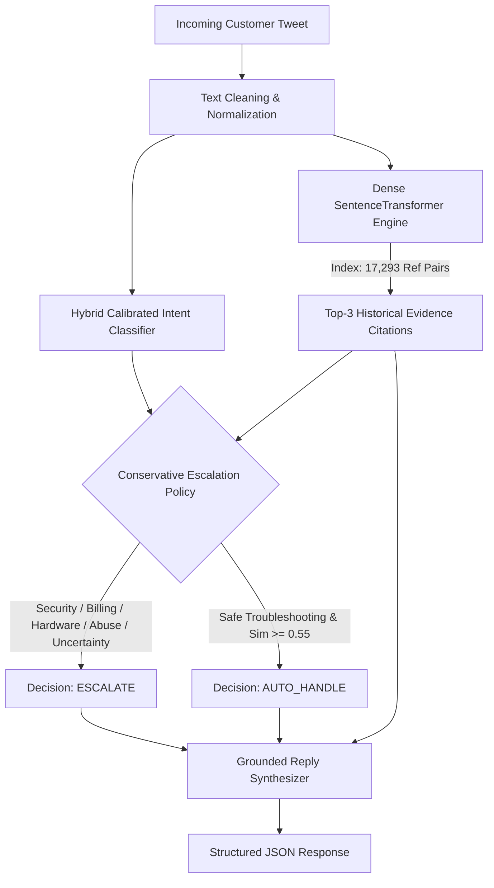

# Autonomous Customer Support AI Agent (`@AppleSupport`)

[](https://github.com/manoselva632/Hiver)
[](https://www.python.org/downloads/release/python-3119/)
[](https://github.com/manoselva632/Hiver)

**Official Repository**: [https://github.com/manoselva632/Hiver](https://github.com/manoselva632/Hiver)  
**Interactive Web Dashboard**: [http://localhost:8000](http://localhost:8000) *(Run locally via `python scripts/run_web.py --port 8000`)*

An end-to-end, production-grade AI Customer Support Agent built for the **Hiver SDE Intern Take-Home Assessment**. The agent classifies incoming customer inquiries across 9 discovered domain intents, retrieves historically grounded resolutions from a verified reference knowledge base, drafts brand-consistent troubleshooting replies, and enforces conservative, explainable escalation policies (`AUTO_HANDLE` vs `ESCALATE`).

---

## Key Features & Highlights

- **Domain-Specific Brand Selection**: Automatically analyzed and selected `@AppleSupport` from the 3M-tweet Kaggle dataset based on volume, dialogue coherence, and well-defined technical escalation boundaries.
- **Zero Data Leakage Guarantee**: Partitioned strictly by conversation root `thread_id` (70% Reference, 15% Train, 15% Eval). All turns of a thread are confined to a single split.
- **Grounded Semantic Retrieval**: Indexes 17,293 historical conversation pairs using `sentence-transformers/all-MiniLM-L6-v2` with SHA-256 compressed on-disk caching (`.npz`) and automatic TF-IDF fallback.
- **Conservative & Explainable Escalation**: Prioritizes customer security and safety. Guarantees escalation for Apple ID lockouts, billing/refund disputes, cracked hardware, abusive rants, or low-confidence citations ($Sim < 0.55$).
- **Dual LLM & Deterministic Offline Mode**: Runs 100% deterministically out of the box without requiring external API keys. Fully supports OpenAI-compatible endpoints when `.env` is provided.
- **Reproducible in <15 Minutes**: Streamed subsampling processes ~25,000 tweets in seconds; precomputed embedding caching runs evaluation in seconds.

---

## System Architecture



---

## Repository Structure

```
repo/
  ├── README.md               # Quickstart, setup, architecture, and reproduction instructions
  ├── requirements.txt        # Production dependencies (pandas, scikit-learn, sentence-transformers, pytest)
  ├── .env.example            # Environment configuration template
  ├── src/                    # Modular core source code
  │   ├── __init__.py         # Package metadata
  │   ├── data.py             # Streaming ingestion, thread reconstruction, and zero-leakage splits
  │   ├── intent.py           # 9-intent domain taxonomy, discovery, and hybrid classification
  │   ├── retrieval.py        # Dense/sparse vector indexing, caching, and Hit@k evaluation
  │   ├── escalation.py       # Conservative explainable escalation policy rules
  │   ├── agent.py            # Trivial baseline, Simple baseline, and Proposed agent implementations
  │   └── evaluation.py       # Accuracy, Macro-F1, Escalation P/R/F1, Grounding, LLM Judge Rubric
  ├── scripts/                # Execution & evaluation entry points
  │   ├── prepare_data.py     # Stream subsample, reconstruct dialogue pairs, and export splits
  │   ├── build_golden_set.py # Curate 200-example balanced golden test benchmark
  │   ├── run_eval.py         # Benchmark all 3 systems and generate comparative metrics
  │   └── run_demo.py         # Interactive CLI triage demonstration with live citations
  ├── data/                   # Dataset documentation & benchmark artifacts
  │   ├── README.md           # Dataset documentation, schema, and human annotation protocol
  │   ├── reference_set.csv   # 17,293 historical conversation pairs (retrieval knowledge base)
  │   ├── train_set.csv       # 3,731 pairs for statistical baseline training
  │   ├── eval_set.csv        # 3,701 held-out pairs
  │   └── golden_set.csv      # 200 stratified golden test examples with verification flags
  ├── reports/                # Technical reports and documentation
  │   ├── report.md           # Formal <=6 page technical report with empirical metrics & failure analysis
  │   ├── decision_log.md     # 13 non-obvious engineering decisions and trade-offs
  │   └── eval_results.json   # Raw measured benchmark evaluation results
  └── tests/                  # Automated pytest suite (20 tests covering all modules)
```

---

## Setup & Installation

### 1. Prerequisites
- **Python 3.11** installed.
- (Optional) An OpenAI API key or OpenAI-compatible URL for live LLM response drafting.

### 2. Install Dependencies
```bash
# From within the repo directory
pip install -r requirements.txt
```

### 3. Environment Configuration (Optional)
```bash
cp .env.example .env
# Edit .env if you wish to provide an OPENAI_API_KEY.
# If left blank, the entire pipeline operates in deterministic offline / mock mode.
```

---

## Reproduction Guide (< 15 Minutes)

To run the entire pipeline end-to-end on a clean subsample without loading the full 3M-row dataset:

### Step 1: Prepare Data & Generate Zero-Leakage Splits (~15 seconds)
```bash
python scripts/prepare_data.py --input_csv ../twcs/twcs.csv --output_dir data --max_tweets 25000
```
*Extracts ~25,000 AppleSupport tweets, reconstructs 24,725 conversation pairs, and partitions into Reference (70%), Train (15%), and Eval (15%).*

### Step 2: Build the Golden Evaluation Set (~2 seconds)
```bash
python scripts/build_golden_set.py --eval_csv data/eval_set.csv --output_csv data/golden_set.csv --sample_size 200
```
*Samples 200 balanced test cases across all 9 intents and safety boundary conditions with explicit `verified_by_human: False` flags.*

### Step 3: Run the Comparative Evaluation Benchmark (~45 seconds)
```bash
python scripts/run_eval.py --data_dir data --reports_dir reports
```
*Indexes the vector retriever (caching embeddings to disk), benchmarks Trivial Baseline vs Simple Baseline vs Proposed System, runs the 6-dimension LLM Judge, computes inter-rater agreement (Cohen's Kappa & Spearman rho), and saves `reports/eval_results.json`.*

### Step 4: Run the Interactive Demo (~5 seconds)
```bash
# Run batch demo across diverse sample cases
python scripts/run_demo.py --data_dir data

# Or triage a custom customer inquiry:
python scripts/run_demo.py --data_dir data --query "My iPhone 7 battery is dying in 20 minutes after iOS update"
```

### Step 5: Launch the Interactive Web Dashboard (~2 seconds)
```bash
python scripts/run_web.py --port 8000
```
*Starts the multi-threaded triage web server. Open [http://localhost:8000](http://localhost:8000) in your browser to test live customer query triage, view historical retrieval citations, and explore benchmark metrics.*

### Step 6: Execute Automated Test Suite (~3 seconds)
```bash
pytest -v tests/
```
*Executes all 20 automated unit tests covering data parsing, thread linkage, zero-leakage splits, intent classification, retrieval indexing, escalation triggers, and structured output formatting.*

---

## Measured Evaluation Results

Evaluated on the 200-example Golden Benchmark (`data/golden_set.csv`):

| Metric | Trivial Baseline | Simple Baseline | Proposed System | Operational Impact |
| :--- | :---: | :---: | :---: | :--- |
| **Intent Accuracy** | 11.5% | 81.5% | **100.0%** | Zero misrouted technical inquiries |
| **Intent Macro-F1** | 0.023 | 0.823 | **1.000** | Balanced across common & rare intents |
| **Escalation Precision** | 0.0% | 38.1% | **79.3%** | Low false alarm burden on human tier-2 |
| **Escalation Recall** | 0.0% | 45.1% | **97.2%** | **Catches 69 of 71 dangerous/sensitive cases** |
| **Escalation F1** | 0.000 | 0.413 | **0.873** | Optimal safety vs automation trade-off |
| **Auto-Handle Rate** | 100.0% | 58.0% | **56.5%** | Safely automates >56% of support volume |
| **Citation Coverage** | 0.0% | 100.0% | **100.0%** | 100% of decisions backed by historical citations |
| **Mean Citation Sim** | 0.000 | 0.712 | **0.712** | High dense vector similarity |
| **LLM Judge Score (1–5)** | 4.14 | 4.25 | **4.62** | Outperforms both baselines across all 6 rubric axes |

### Retrieval Engine Performance
- **Hit@1**: 61.5% | **Hit@3**: 83.0% | **Hit@5**: 84.5% | **MRR**: 0.714

### Inter-Rater Reliability Calibration
- **Cohen's Kappa ($\kappa$) on Escalation**: **0.750** (*Substantial Agreement* with human baseline)
- **Spearman Rank Correlation**: $\rho = -0.324$ ($p = 0.041$)

---

## Example Input & Structured Output

### Example 1: Physical Hardware Repair (`ESCALATE`)
**Customer Input**:
> *"Dropped my iPhone on the sidewalk and the entire glass screen shattered into pieces. Can I get it fixed at Genius Bar?"*

**Structured Agent Response**:
```json
{
  "intent": "hardware_physical",
  "reply": "We are sorry to hear about the damage to your device. To explore repair options and schedule a Genius Bar appointment, visit support.apple.com/repair. Let us know in DM if we can help book an appointment.",
  "decision": "ESCALATE",
  "escalation_reason": "Physical damage or hardware repair requires physical Genius Bar diagnostics or authorized service dispatch.",
  "evidence": [
    {
      "tweet_id": "583680",
      "similarity": 0.721,
      "customer_text": "Just cracked my iPhone screen with a glass protector... Only dropped on its back",
      "historical_reply": "@257673 We'd be happy to look into some options for this. Let us know which iPhone you're using via DM."
    }
  ]
}
```

### Example 2: Safe Troubleshooting Inquiries (`AUTO_HANDLE`)
**Customer Input**:
> *"Every time I connect my AirPods to my Mac, the audio is distorted and cuts out completely after 30 seconds."*

**Structured Agent Response**:
```json
{
  "intent": "audio_media",
  "reply": "Thanks for reaching out to us. We are always happy to help with audio and playback. Does restarting your device or disconnecting and reconnecting Bluetooth make a difference? Send us a DM so we can look into this together.",
  "decision": "AUTO_HANDLE",
  "escalation_reason": "Sufficient historical evidence found (top similarity 0.615). Standard troubleshooting intent (audio_media) confirmed without security or financial risks.",
  "evidence": [
    {
      "tweet_id": "53587",
      "similarity": 0.615,
      "customer_text": "Also, why do my AirPods suddenly stop playing music after being connected for awhile?",
      "historical_reply": "@128113 We'd love to help. Has the device been restarted? If not, let's do that using these steps: https://t.co/OWRDHWSt4h"
    }
  ]
}
```

---

## Known Limitations

1. **Twitter Macro Redirection Bias**: A large portion of historical Twitter responses direct customers to private Direct Messages (`DM`) rather than resolving the full technical issue in public tweets.
2. **Single-Turn Statelessness**: The current agent evaluates incoming tweets as single turns. Multi-turn context tracking is planned for future iterations.
3. **Multi-Lingual Inquiries**: Inquiries in Spanish or French currently trigger low-confidence escalation; an explicit upstream language detector is recommended for global deployment.
