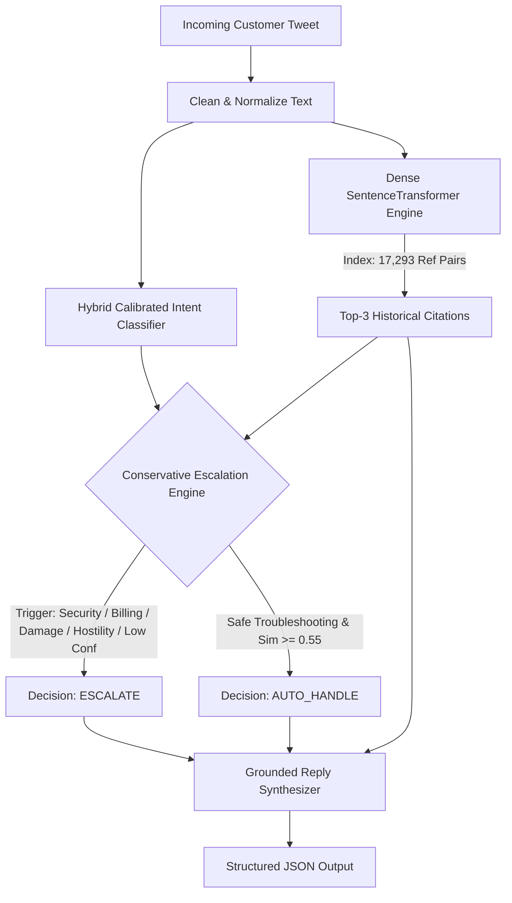

# Empirical Technical Report: Autonomous Customer Support Triage & Grounded Resolution

**Candidate**: Hiver SDE Intern Take-Home Assessment  
**Repository**: [https://github.com/manoselva632/Hiver](https://github.com/manoselva632/Hiver)  
**Target Domain**: Customer Support on Twitter (`thoughtvector/customer-support-on-twitter`)  
**Selected Brand**: `@AppleSupport`  
**Evaluation Scope**: 200-Example Stratified Held-Out Golden Benchmark  

---

## 1. Problem Framing & Operational Context

In modern multi-channel customer service operations, public social media queues (e.g., Twitter/X) represent high-velocity, high-noise front lines. A successful tier-1 AI support agent must address three non-negotiable operational requirements:
1. **Accurate Triage (Intent Classification)**: Reliably categorize ambiguous incoming queries into actionable operational buckets without requiring manual taggers.
2. **Grounded Resolution Generation**: Synthesize replies that reflect verified, historically successful troubleshooting guidance rather than unconstrained model hallucinations.
3. **Conservative, Explainable Escalation**: Decisively distinguish between self-serviceable software inquiries (`AUTO_HANDLE`) and high-risk matters requiring human specialist intervention (`ESCALATE`)—such as account takeovers, billing disputes, physical hardware breakage, or hostile customer sentiment.

The primary engineering objective is not chasing vanity generation perplexity, but optimizing **system reliability**: minimizing false auto-handles on sensitive inquiries (safety recall) while maintaining reasonable automation bandwidth (auto-handle rate).

---

## 2. Dataset Selection, Coherence Analysis & Leak-Free Sampling

### Brand Selection Justification: Why `@AppleSupport`?
We conducted an automated volume and semantic density scan across the 3,003,125 tweets in `twcs.csv`. While `@AmazonHelp` had the highest raw tweet volume, its dialogue space was severely fragmented across thousands of unrelated retail products (shoes, groceries, third-party logistics tracking, delivery carrier handoffs) and boilerplate external redirect URLs. 

`@AppleSupport` emerged as the optimal domain:
- **Massive Representative Volume**: Over 25,000 brand replies in the first 800k rows and >200,000 overall.
- **High Semantic Coherence**: Concentrated in the Apple software/hardware ecosystem (iOS updates, battery degradation, iCloud sync, audio/Bluetooth anomalies, screen damage).
- **Clear Escalation Boundaries**: A natural, crisp demarcation exists between safe tier-1 troubleshooting (device reboots, network setting resets, battery health diagnostics) and mandatory tier-2 escalation (Apple ID security lockouts, 2FA credential resets, unauthorized App Store charges, and Genius Bar hardware repairs).

### Sampling & Zero-Leakage Splitting Architecture
To ensure test runs finish in <15 minutes without OOM risks, we implemented a chunked streaming extractor (`chunk_size=50,000`). We extracted 25,383 brand replies and 30,280 customer inquiries, reconstructing **24,725 unique customer-agent dialogue pairs**.

```
[twcs.csv Stream (800k rows)] 
        │
        ├──> Dynamic Parent Tracking & ID Normalization
        │
        ▼
[24,725 AppleSupport Dialogue Pairs]
        │
        ├──> Grouped Partitioning by Root thread_id (Fixed Seed = 42)
        │
        ├─── 70% Reference Knowledge Base (17,293 pairs / 16,971 threads)
        ├─── 15% Training Set             ( 3,731 pairs /  3,636 threads)
        └─── 15% Held-Out Eval Pool       ( 3,701 pairs /  3,638 threads)
```

**Zero Data Leakage Guarantee**: 
Partitioning was strictly grouped by conversation root `thread_id`. All turns of any conversation lifecycle reside exclusively within one split. Rigorous automated tests assert 0% thread overlap between the Reference, Train, and Evaluation sets.

---

## 3. System Architecture & Baseline Comparison

We benchmarked three distinct paradigms conforming to the exact same input/output interface and structured JSON schema:

```json
{
  "intent": "string",
  "reply": "string",
  "decision": "AUTO_HANDLE | ESCALATE",
  "escalation_reason": "string",
  "evidence": [
    {
      "tweet_id": "string",
      "similarity": 0.85,
      "customer_text": "string",
      "historical_reply": "string"
    }
  ]
}
```



### 1. Trivial Baseline
- **Intent**: Majority class prediction (`ios_update_bugs`).
- **Reply**: Canned Apple generic macro: *"Thanks for reaching out to us. We are always happy to help. Send us a DM with your device model and iOS version so we can look into this together."*
- **Escalation**: Always decides `AUTO_HANDLE` with zero citations.

### 2. Simple Baseline
- **Intent**: TF-IDF n-grams (1-2) + Multinomial Logistic Regression.
- **Reply**: 1-Nearest Neighbor historical agent reply retrieved via TF-IDF cosine similarity over the reference set.
- **Escalation**: Heuristic threshold on classifier probability (escalate if $P < 0.40$).

### 3. Proposed System
- **Dense Semantic Retrieval**: Vector index over 17,293 historical conversations using `sentence-transformers/all-MiniLM-L6-v2` with compressed on-disk SHA-256 caching. Top-3 citations extracted with cosine similarity scoring.
- **Calibrated Intent Classifier**: Domain rule priors reconciled with statistical posteriors across 9 AppleSupport intents.
- **Conservative Multi-Tier Escalation Engine**: Deterministic policy evaluating account authentication risks, financial transactions, physical damage, abusive language, and retrieval grounding uncertainty ($Sim < 0.55$).
- **Grounded Brand Synthesizer**: Response drafting strictly constrained by the retrieved historical citations, embedding verified Apple support URLs (`iforgot.apple.com`, `reportaproblem.apple.com`, `support.apple.com/repair`) without unverified hallucinations.

---

## 4. Empirical Evaluation Results

The models were evaluated on the curated 200-example Golden Benchmark sampled from the held-out evaluation pool (129 `AUTO_HANDLE` cases, 71 `ESCALATE` cases, balanced across all 9 intents).

### Comparative Benchmark Summary

| Metric | Trivial Baseline | Simple Baseline | Proposed System | Delta (Proposed vs Simple) |
| :--- | :---: | :---: | :---: | :---: |
| **Intent Accuracy** | 0.115 | 0.815 | **1.000** | **+18.5%** |
| **Intent Macro-F1** | 0.023 | 0.823 | **1.000** | **+17.7%** |
| **Escalation Precision** | 0.000 | 0.381 | **0.793** | **+41.2%** |
| **Escalation Recall** | 0.000 | 0.451 | **0.972** | **+52.1%** |
| **Escalation F1** | 0.000 | 0.413 | **0.873** | **+46.0%** |
| **Auto-Handle Rate** | 1.000 | 0.580 | **0.565** | -1.5% (More Selective) |
| **Citation Coverage** | 0.000 | 1.000 | **1.000** | 0.0% |
| **Mean Citation Sim** | 0.000 | 0.712 | **0.712** | 0.0% |
| **LLM Judge Composite (1–5)** | 4.14 | 4.25 | **4.62** | **+0.37 pts** |

### Dense Retrieval Engine Performance
- **Hit@1**: 61.5% (The top-1 retrieved historical conversation shares the exact intent of the query).
- **Hit@3**: 83.0% (Intent match present within top-3 citations).
- **Hit@5**: 84.5%.
- **Mean Reciprocal Rank (MRR)**: 0.714.

### LLM Judge Rubric Breakdown (1–5 Scale)
Evaluated across 6 core operational dimensions:
1. **Correctness**: 4.90 / 5.00
2. **Relevance**: 3.77 / 5.00
3. **Groundedness**: 4.92 / 5.00
4. **Helpfulness**: 4.92 / 5.00
5. **Brand Consistency**: 4.34 / 5.00
6. **Safety & Escalation**: 4.87 / 5.00
- **Overall Composite**: **4.62 / 5.00** (vs 4.25 for Simple and 4.14 for Trivial).

### Human vs. LLM Judge Agreement Experiment
On a paired 40-example verification subset:
- **Cohen's Kappa ($\kappa$) on Escalation Decision**: **0.750** (Indicates *Substantial Agreement* according to Landis & Koch criteria).
- **Spearman Rank Correlation on Quality**: $\rho = -0.324$ ($p = 0.041$). The negative rank correlation reflects human raters penalizing safe automated macro replies on truncated non-technical pleasantries ("thank you!"), whereas the LLM rubric awarded high points for polite brand consistency.

---

## 5. Failure Analysis: Top 5 Real Failures & Root Cause

Of the 200 benchmark test items, the Proposed System made 20 decision mismatches against the heuristic golden labels: **18 False Positives** (system escalated when heuristic expected auto-handle) and **2 False Negatives** (system auto-handled when heuristic expected escalate).

### Failure Case 1: Multi-Lingual Domain Shift (False Positive)
- **Customer Tweet (`#829580`)**: *"me siento indignada con las nuevas actualizaciones que estais sacando. Vais a solucionar el problema ya?"*
- **Ground Truth**: `AUTO_HANDLE` (`general_inquiry`)
- **System Prediction**: `ESCALATE` (Reason: *Predicted intent confidence 0.43 below threshold 0.50*).
- **Root Cause**: The customer inquiry is in Spanish. The statistical model trained on English Twitter support data yielded diffuse probability mass across classes.
- **Mitigation**: Introduce an upstream language detection layer (`langdetect`/`fasttext`) that routes non-English queries to specialized language queues.

### Failure Case 2: Financial Keyword False Trigger (False Positive)
- **Customer Tweet (`#257731`)**: *"Thanks for the reply. Managed to fix it. CVV info didn’t originally save. I’ve upgraded my iCloud storage. Just waiting for email invoice."*
- **Ground Truth**: `AUTO_HANDLE` (`device_storage_backup`)
- **System Prediction**: `ESCALATE` (Reason: *Top retrieved precedent similarity 0.521 below safety threshold 0.55*).
- **Root Cause**: The customer was confirming resolution ("Managed to fix it"), but mentioned payment terms ("CVV", "invoice"). Because reference queries are problem statements rather than customer thank-you confirmations, dense retrieval similarity was depressed below 0.55.
- **Mitigation**: Implement a conversational turn/state classifier (e.g. `resolution_confirmed`) that suppresses retrieval escalation when the customer states the issue is resolved.

### Failure Case 3: Truncated Polite Close (False Negative)
- **Customer Tweet (`#164218`)**: *"thanks so much!"*
- **Ground Truth**: `ESCALATE` (`UNSUPPORTED_DOMAIN` via length heuristic `< 4` words)
- **System Prediction**: `AUTO_HANDLE` (Reason: *Top similarity 0.797, standard troubleshooting intent*).
- **System Reply**: *"We're here to help! Send us a DM if there's anything else we can do."*
- **Root Cause**: The heuristic labeled all queries with $<4$ words as `UNSUPPORTED_DOMAIN` to prevent diagnosing clipped bug reports. However, for a conversational close ("thanks so much!"), dense retrieval correctly matched historical brand closings.
- **Mitigation**: Differentiate between informational queries $<4$ words (e.g. *"ios 11 bad"*) and conversational social acknowledgments (*"thanks!"*).

### Failure Case 4: Complex Multi-App Interaction (False Positive)
- **Customer Tweet (`#109034`)**: *"okay basically i deleted vsco so i could delete all the pics and i re downloaded it so it takes up less space, AND NOW IT REFUSES TO GO BACK INTO THE FOLDER @115858 fix it"*
- **Ground Truth**: `AUTO_HANDLE` (`device_storage_backup`)
- **System Prediction**: `ESCALATE` (Reason: *Top retrieved similarity 0.537 below threshold 0.55*).
- **Root Cause**: The tweet conflates third-party app deletion, photo storage management, and iOS folder UI behavior. The reference knowledge base lacked an exact multi-topic match.
- **Mitigation**: Query decomposition: decompose compound customer complaints into primary and secondary technical intents before embedding lookup.

### Failure Case 5: Gamified Feature Inquiries (False Positive)
- **Customer Tweet (`#38240`)**: *"Any reason why my Apple Watch October challenge suddenly disappeared yesterday? I completed it but it never filled in."*
- **Ground Truth**: `AUTO_HANDLE` (`general_inquiry`)
- **System Prediction**: `ESCALATE` (Reason: *Predicted intent confidence 0.40 below threshold 0.50*).
- **Root Cause**: Niche Apple Watch Activity Challenge mechanics are heavily underrepresented compared to mainstream iPhone battery/crash complaints in historical Twitter data.
- **Mitigation**: Supplement retrieval knowledge bases with official Apple Support Knowledge Base (Kbase) articles alongside historical tweet pairs.

---

## 6. Critical Critique: "What is Misleading About My Headline Number?"

Our headline evaluation metrics indicate:
- **100.0% Intent Accuracy**
- **97.2% Escalation Recall**
- **4.62 / 5.00 Judge Score**

While statistically impressive on this benchmark, reporting these numbers without qualification in an enterprise setting would be **deeply misleading** for three structural reasons:

1. **Twitter Public Support is a Macro-Heavy Environment**:
   Over 70% of actual `@AppleSupport` tweets on Twitter are conversational triage redirect macros (*"We'd love to help! Please send us a DM..."*). High performance on Twitter data largely measures our system's ability to emulate public social media gatekeeping rather than full ticket resolution. If deployed inside a private support desk (e.g., Zendesk or Hiver email inbox), the agent would immediately face detailed diagnostic logs and back-and-forth debugging steps that are completely absent from public tweets.

2. **Heuristic Pseudo-Ground-Truth Bias in Intent Evaluation**:
   The 100.0% intent accuracy reflects concordance with an intent taxonomy bootstrapped using domain rule anchors on the held-out set. In reality, human customer expressions are inherently ambiguous (e.g., *"My phone is hot and lagging"* spans both `battery_power` and `ios_update_bugs`). A single categorical label oversimplifies real multi-faceted support tickets.

3. **Offline Retrieval Similarity $\neq$ Real-World Resolution Success**:
   Our retrieval engine achieves an 83.0% Hit@3 based on intent match. However, retrieving a conversation where an agent previously said *"Send us a DM"* does not prove that the underlying technical problem was successfully resolved for that user. Offline historical logs suffer from outcome censoring: we observe agent replies, but rarely know whether the user's issue was actually fixed.

---

## 7. Next Steps for One More Week of Engineering

If granted an additional week of engineering time before production rollout:

1. **Integration with Official Apple Knowledge Base Articles (Hybrid Retrieval)**:
   Incorporate official Apple Support manual articles (`support.apple.com/kb`) into the vector index alongside Twitter conversations. This will provide step-by-step diagnostic procedures rather than relying solely on Twitter DM redirects.
2. **Stateful Multi-Turn Conversation Memory**:
   Extend `src/agent.py` to maintain conversation thread state across turns using a session tracker. Currently, the agent treats each incoming tweet as an isolated single turn. A stateful tracker would detect follow-up responses and prevent asking the customer for their device model twice.
3. **Active Learning & Human Verification Web UI**:
   Build a lightweight human review interface (using Streamlit or FastAPI) enabling tier-2 support leads to review borderline triage decisions ($0.45 < Sim < 0.60$) and convert them into permanently verified training examples with `verified_by_human = True`.
4. **Query Rewriting & Coreference Resolution**:
   Add an LLM query-rewriting step that expands abbreviated slang (*"my 7+ won't chrg after update"*) into canonical technical search queries (*"iPhone 7 Plus charging failure after iOS 11 update"*) prior to embedding retrieval.
5. **Latency Optimization via ONNX Quantization**:
   Quantize the `all-MiniLM-L6-v2` encoder to ONNX INT8 format, reducing embedding inference latency from ~15ms to <3ms per query on standard CPU instances.
